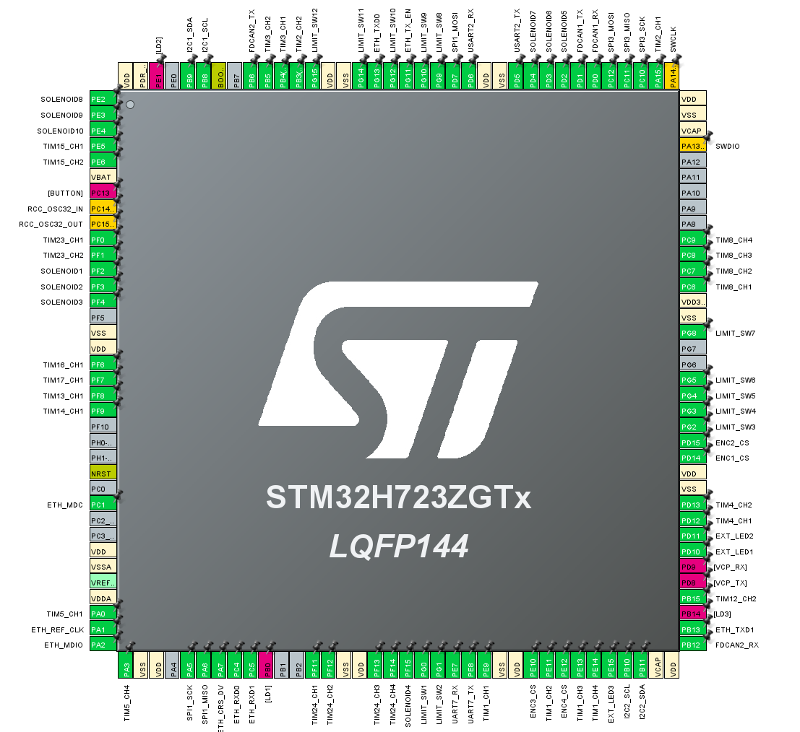

# Altair Nexus Driver Module

## 概要

Altair Nexus Driver Module は、STM32H723ZGT6（NUCLEO-H723ZG）を制御コアとするロボット統合制御基板です。
高密度な周辺機能を単一のマイコンに集約し、エンコーダ8系統、モータPWM 16出力、サーボPWM 6出力、有線LAN通信、CAN通信2系統、シリアル通信3系統、各種センサ用バス、リミットスイッチ12入力、電磁弁10出力、外部LED 3出力をすべて競合なく同時成立させる設計となっています。

## ハードウェア仕様

* マイコン: STM32H723ZGT6（LQFP144パッケージ、Arm Cortex-M7 最大550MHz）
* 評価ボード: NUCLEO-H723ZG（ボード型番 MB1364）
* 設定ツール: STM32CubeMX 6.17.0
* ビルド環境: CMake / GCC

## 機能一覧

* 絶対角エンコーダ: 4系統（SPI1バス共用、個別CSピン制御）
* 増分式エンコーダ: 4系統（TIM2 / TIM3 / TIM4 / TIM23 エンコーダモード）
* Ethernet通信: 1系統（RMII接続、オンボードPHY LAN8742A）
* モータPWM出力: 16出力（TIM1 / TIM8 / TIM24 / TIM12 / TIM15、周波数20kHz）
* サーボPWM出力: 6出力（TIM5 / TIM13 / TIM14 / TIM16 / TIM17、周波数50Hz、外部IC不要）
* CAN通信: 2系統（FDCAN1 / FDCAN2、外部5Vトランシーバ接続）
* シリアル通信: 3系統（USART3 ST-LINK仮想COMポート、USART2、UART7）
* 拡張バス: SPI 1系統（SPI3）、I2C 2系統（I2C1 / I2C2）
* デジタル入力: 12点（リミットスイッチ用 GPIO入力、LIMIT_SW1からLIMIT_SW12）
* デジタル出力: 10点（電磁弁駆動用 GPIO出力、SOLENOID1からSOLENOID10）
* 外部LED出力: 3点（外部インジケータ用 GPIO出力、EXT_LED1からEXT_LED3）

## ピン配置および設定一覧

### エンコーダ 8系統

| 用途 | 信号名 | MCUピン | Alternate Function | コネクタ番号 | 設定 / 備考 |
| :--- | :--- | :--- | :--- | :--- | :--- |
| 絶対角1から4 | SPI1_SCK | PA5 | AF5 | CN9 ピン9 | クロック信号共用 |
| 絶対角1から4 | SPI1_MISO | PA6 | AF5 | CN9 ピン13 | データ入力（5V駆動時はレベル変換要否確認） |
| 絶対角1から4 | SPI1_MOSI | PD7 | AF5 | CN9 ピン4 | コマンド出力共用 |
| 絶対角1 CS | ENC1_CS | PD14 | - | CN7 ピン16 | GPIO_Output（アクティブLow） |
| 絶対角2 CS | ENC2_CS | PD15 | - | CN7 ピン18 | GPIO_Output（アクティブLow） |
| 絶対角3 CS | ENC3_CS | PE10 | - | CN10 ピン25 | GPIO_Output（アクティブLow） |
| 絶対角4 CS | ENC4_CS | PE12 | - | CN10 ピン27 | GPIO_Output（アクティブLow） |
| 増分式1 A/B相 | TIM2_CH1 / CH2 | PA15 / PB3 | AF1 | CN7 ピン17 / CN7 ピン7 | 32-bit、Encoder Mode（PB3はSWO解除済み） |
| 増分式2 A/B相 | TIM3_CH1 / CH2 | PB4 / PB5 | AF2 | CN7 ピン27 / CN7 ピン29 | 16-bit、Encoder Mode |
| 増分式3 A/B相 | TIM4_CH1 / CH2 | PD12 / PD13 | AF2 | CN10 ピン19 / CN10 ピン21 | 16-bit、Encoder Mode |
| 増分式4 A/B相 | TIM23_CH1 / CH2 | PF0 / PF1 | AF13 | CN11 ピン51 / CN11 ピン53 | 32-bit、Encoder Mode（基板SB44/46設定確認） |

### Ethernet RMII

| 信号名 | MCUピン | Alternate Function | コネクタ / 接続先 | 設定 / 備考 |
| :--- | :--- | :--- | :--- | :--- |
| ETH_REF_CLK | PA1 | AF11 | オンボード LAN8742A | 50MHzクロック入力 |
| ETH_MDIO | PA2 | AF11 | オンボード LAN8742A | 管理データ入出力 |
| ETH_MDC | PC1 | AF11 | オンボード LAN8742A | 管理クロック出力 |
| ETH_CRS_DV | PA7 | AF11 | オンボード LAN8742A | 受信データ有効信号 |
| ETH_RXD0 | PC4 | AF11 | オンボード LAN8742A | 受信データ0 |
| ETH_RXD1 | PC5 | AF11 | オンボード LAN8742A | 受信データ1 |
| ETH_TX_EN | PG11 | AF11 | オンボード LAN8742A | 送信イネーブル |
| ETH_TXD0 | PG13 | AF11 | オンボード LAN8742A | 送信データ0 |
| ETH_TXD1 | PB13 | AF11 | オンボード LAN8742A | 送信データ1 |

### モータ制御用PWM 16出力

すべて周波数20kHz、Prescaler: 0、Counter Period: 4799、分解能4800段階で統一されています。

| 用途 | タイマー | チャンネル | MCUピン | Alternate Function | コネクタ番号 |
| :--- | :--- | :--- | :--- | :--- | :--- |
| M1_PWM1 | TIM1 | CH1 | PE9 | AF1 | CN10 ピン21 |
| M1_PWM2 | TIM1 | CH2 | PE11 | AF1 | CN10 ピン23 |
| M2_PWM1 | TIM1 | CH3 | PE13 | AF1 | CN10 ピン29 |
| M2_PWM2 | TIM1 | CH4 | PE14 | AF1 | CN10 ピン31 |
| M3_PWM1 | TIM8 | CH1 | PC6 | AF3 | CN7 ピン1 |
| M3_PWM2 | TIM8 | CH2 | PC7 | AF3 | CN7 ピン2 |
| M4_PWM1 | TIM8 | CH3 | PC8 | AF3 | CN8 ピン2 |
| M4_PWM2 | TIM8 | CH4 | PC9 | AF3 | CN8 ピン4 |
| M5_PWM1 | TIM24 | CH1 | PF11 | AF14 | CN12 ピン42 |
| M5_PWM2 | TIM24 | CH2 | PF12 | AF14 | CN10 ピン5 |
| M6_PWM1 | TIM24 | CH3 | PF13 | AF14 | CN10 ピン7 |
| M6_PWM2 | TIM24 | CH4 | PF14 | AF14 | CN10 ピン9 |
| M7_PWM1 | TIM12 | CH1 | PB14 | AF2 | CN12 ピン36（オンボード赤LED LD3接続） |
| M7_PWM2 | TIM12 | CH2 | PB15 | AF2 | CN12 ピン38 |
| M8_PWM1 | TIM15 | CH1 | PE5 | AF4 | CN9 ピン3 |
| M8_PWM2 | TIM15 | CH2 | PE6 | AF4 | CN9 ピン5 |

### サーボモータ制御用PWM 6出力

すべて周波数50Hz（周期20ms）、Prescaler: 95、Counter Period: 19999、1マイクロ秒分解能で統一されています。

| 用途 | タイマー | チャンネル | MCUピン | Alternate Function | コネクタ番号 |
| :--- | :--- | :--- | :--- | :--- | :--- |
| SERVO1 | TIM5 | CH1 | PA0 | AF2 | CN8 ピン1 |
| SERVO2 | TIM5 | CH4 | PA3 | AF2 | CN9 ピン1（CH2/CH3はEthernet使用のため無効） |
| SERVO3 | TIM13 | CH1 | PF8 | AF9 | CN9 ピン15 |
| SERVO4 | TIM14 | CH1 | PF9 | AF9 | CN9 ピン11 |
| SERVO5 | TIM16 | CH1 | PF6 | AF1 | CN11 ピン47 / CN9 ピン5 |
| SERVO6 | TIM17 | CH1 | PF7 | AF1 | CN9 ピン9 |

### 通信インターフェース

| 用途 | 周辺機能 | 信号名 | MCUピン | Alternate Function | 備考 |
| :--- | :--- | :--- | :--- | :--- | :--- |
| CAN 1 | FDCAN1 | RX / TX | PD0 / PD1 | AF9 | 外部5Vトランシーバ接続 |
| CAN 2 | FDCAN2 | RX / TX | PB12 / PB6 | AF9 | 外部5Vトランシーバ接続（PB13回避） |
| デバッグUART | USART3 | TX / RX | PD8 / PD9 | AF7 | オンボードST-LINK VCP接続（115200bps） |
| 外部UART 1 | USART2 | TX / RX | PD5 / PD6 | AF7 | 外部通信用（115200bps） |
| 外部UART 2 | UART7 | RX / TX | PE7 / PE8 | AF7 | 外部通信用（115200bps） |
| 拡張SPI | SPI3 | SCK / MISO / MOSI | PC10 / PC11 / PC12 | AF6 | 拡張センサ / モジュール用 |
| 拡張I2C 1 | I2C1 | SCL / SDA | PB8 / PB9 | AF4 | 外部プルアップ抵抗要 |
| 拡張I2C 2 | I2C2 | SCL / SDA | PB10 / PB11 | AF4 | 外部プルアップ抵抗要 |

### デジタル入出力（リミットスイッチ / 電磁弁 / 外部LED）

| 用途 | 信号名 / ラベル | MCUピン | 入出力 | コネクタ番号 | 備考 |
| :--- | :--- | :--- | :--- | :--- | :--- |
| リミットスイッチ1から6 | LIMIT_SW1からLIMIT_SW6 | PG0からPG5 | GPIO_Input | CN11 ピン49,51,53,55,57,59 | プルアップ回路要 |
| リミットスイッチ7 / 8 | LIMIT_SW7 / LIMIT_SW8 | PG8 / PG9 | GPIO_Input | CN11 ピン61 / CN12 ピン40 | USB信号（PG6/PG7）を回避 |
| リミットスイッチ9から12 | LIMIT_SW9からLIMIT_SW12 | PG10, PG12, PG14, PG15 | GPIO_Input | CN11 ピン66,65 / CN12 ピン64,66 | 新設リミットスイッチ（Port G統一） |
| 電磁弁駆動 1から3 | SOLENOID1からSOLENOID3 | PF2からPF4 | GPIO_Output | CN11 ピン56,58,60 | 外部MOSFET経由で駆動 |
| 電磁弁駆動 4 | SOLENOID4 | PF15 | GPIO_Output | CN11 ピン38 | 同上 |
| 電磁弁駆動 5から7 | SOLENOID5からSOLENOID7 | PD2からPD4 | GPIO_Output | CN11 ピン42,44,46 | 同上 |
| 電磁弁駆動 8から10 | SOLENOID8からSOLENOID10 | PE2からPE4 | GPIO_Output | CN11 ピン50,52,54 | 同上 |
| 外部LED 1から3 | EXT_LED1からEXT_LED3 | PD10, PD11, PE15 | GPIO_Output | CN10 ピン33,35 / CN10 ピン13 | 外部インジケータLED用 |

### ボード機能およびデバッグ

| 用途 | 信号名 | MCUピン | 備考 |
| :--- | :--- | :--- | :--- |
| デバッグ | SWDIO / SWCLK | PA13 / PA14 | ST-LINK デバッグ端子（SWD接続） |
| ユーザーボタン | BUTTON | PC13 | オンボード青ボタン B1 |
| LED 1 | LD1（緑） | PB0 | オンボード緑LED |
| LED 2 | LD2（黄） | PE1 | オンボード黄LED |
| LED 3 | LD3（赤） | PB14 | オンボード赤LED（TIM12_CH1とピン共有） |
| RTC発振 | OSC32_IN / OUT | PC14 / PC15 | オンボード32.768kHz水晶振動子 |

## ハードウェア実装上の注意点

* PB3のデバッグトレース解放
  TIM2_CH2として使用するPB3は、基板初期状態でST-LINKのSWO端子と接続されています。CubeMXのSYS Debug設定はSerial Wireに設定し、SWO機能を無効化してください。
* PB14の赤色LED負荷
  TIM12_CH1として使用するPB14は、基板上の赤色LED（LD3）に直結しています。モータPWMパルスによりLEDが高速点滅します。信号波形の立ち上がりへの影響が懸念される場合は、基板上のLED直列抵抗を取り外してください。
* PF0およびPF1のソルダブリッジ設定
  TIM23のCH1およびCH2として使用するPF0とPF1は、NUCLEO基板（MB1364）上で外部水晶発振子やST-LINK MCOクロックとパターンが共用されている場合があります。UM2407を参照し、SB44およびSB46を導通状態にして外部端子CN11へ接続してください。
* 絶対角エンコーダの電圧レベル
  AMT203-Vを5V電源で駆動する場合、SPI1_MISO（PA6）に入力される信号レベルがマイコンの耐圧を超えないよう、必要に応じてレベルシフタ回路を挿入してください。
* 電源系統の分離
  モータ駆動用大電流回路、電磁弁の誘導負荷駆動回路、サーボ電源ラインは、マイコンの3.3V制御電源とグランドプレーンおよびDC-DC電源を完全に分離してください。
